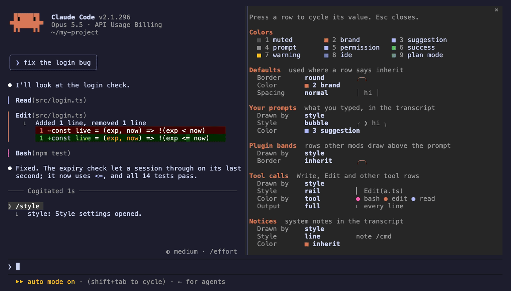

# claude-style

[](https://github.com/msetsma/claude-style/actions/workflows/ci.yml)

A Claude Code mod (hooks-module plugin) named `style`. It restyles parts of
Claude Code's UI, and `/style` opens a pane where each part is set:



| Part | Options |
|---|---|
| Defaults | palette (Claude theme or a built-in one), border (round, single, double, bold, dashed, classic), color, spacing (compact, normal, roomy), labels in the top border or inside |
| Your prompts | bubble, bar or plain; left or right aligned; color; fill; a label |
| Replies (Claude's text between tool calls) | card, rail or rule; color; fill; a label, its text your own, on a reply's first block; card width full or fit |
| Plugin bands (rows other mods draw above the prompt) | a frame in a border, with a label |
| Tool calls | rail, card or compact, each a `Tool(target)` line without Claude Code's dot (a card with border labels puts the tool's name in the border); colored by tool, status or one color; card fill; output full, summarized or hidden, a press on `▸` opens it (errors and ctrl+o always show it whole) |
| Notices | line or card; color; a card label |
| Mode badge | solid pills, pills capped with half blocks (any font) or Nerd Font glyphs, brackets or plain; color |
| Prompt hint | color, dimmed |
| Questions | a tab over the dialog in a border and color, its label your own |
| Turn time | a rule across the width, compact or hidden; with or without the verb |

Every part except Defaults has a Drawn by row: `style` draws it as set, `Claude Code`
leaves it as Claude Code draws it and dims the part's other rows, which then take no input.

In the pane, Tab and Shift+Tab move between rows, ↑ and ↓ change a row's value and
Enter sets it; a label row is a field, Enter saves it (empty for none). Preview, or
`/style preview`, prints a labeled sample of every part into the transcript, drawn
by the same code as the parts themselves. Settings persist across sessions.

Colors are nine numbered slots, 1 to 9, shown as a legend at the top of the pane.
Under the `Claude theme` palette each slot is a theme key, so custom Claude Code
themes apply; the built-in palettes are Catppuccin, Dracula, Tokyo Night, Gruvbox,
Nord, One Dark, Solarized, Rosé Pine, Monokai and Everforest, each in its dark
variant. A fill paints a card's inside in the palette's surface tint, or in a slot's
color with dark text; the `surface` fill needs a built-in palette.

Claude Code draws some things itself with no hook for a mod: the prompt input
box, the divider of a docked pane, the permission dialog and the welcome
banner.

## Install

This repo is also a plugin marketplace (`claude-style`):

```sh
claude plugin marketplace add msetsma/claude-style
claude plugin install style@claude-style
```

> [!IMPORTANT]
> Plugins nest in their `enabledPlugins` order in `~/.claude/settings.json`,
> first outermost. A mod that draws a band above the prompt without calling
> `next` hides it from everything after it, so keep `style` first in
> `enabledPlugins` for its band frame to reach other mods' bands.

## Layout

```text
.claude-plugin/plugin.json        # name, version, description, types
.claude-plugin/marketplace.json   # makes the repo installable as a marketplace
hooks/hooks.json                  # { "modules": ["./register.tsx"] }
hooks/register.tsx                # the hooks: which site draws what
hooks/settings.ts                 # options, defaults, loading stored settings
hooks/palettes.ts                 # the built-in palettes and slot colors
hooks/draw.tsx                    # each site's drawing
hooks/pane.tsx                    # the /style pane
types/index.d.ts                  # the settings the mod keeps in $.state
tests/style.test.tsx
demo/                             # the README GIF: vhs tape, setup, offline fake API
```

`.claude-plugin/types/` is generated by Claude Code on load and is gitignored.

## Editing

Clone the repo and work from the clone:

```sh
git clone https://github.com/msetsma/claude-style
cd claude-style
claude plugin validate .
claude plugin test .
```

For a watched dev loop that reloads on every save, start a session with
`claude --plugin-dir <clone>`. Otherwise run `/reload-plugins` in that session
after an edit.

`vhs demo/demo.tape` regenerates `demo/demo.gif` from the repo root. It needs
`vhs`, `node` and `claude`, and runs offline against `demo/fake-api.mjs` in a
throwaway `HOME`.

> [!NOTE]
> An installed copy (`style@claude-style`) is a cached snapshot: it sees pushed
> changes only after `claude plugin marketplace update claude-style`.
